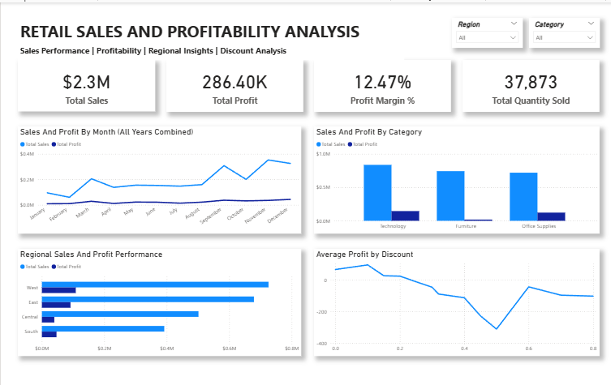

# Retail Sales & Profitability Analysis

## Project Overview

This project analyzes retail sales data to understand sales performance, profitability, regional trends, category performance, and the relationship between discounts and profit.

The analysis was performed using Excel, MySQL, and Power BI, covering the workflow from data preparation and SQL analysis to interactive dashboard development.

## Business Objectives

- Analyze overall sales and profitability performance
- Compare sales and profit across product categories
- Evaluate regional performance
- Examine the relationship between discount levels and profitability
- Identify product sub-categories contributing to profit and loss
- Analyze monthly sales and profit patterns

## Tools Used

- Excel – Initial data inspection and preparation
- MySQL – SQL-based analysis and aggregation
- Power BI – Data modeling, DAX measures, visualization, and dashboard development

## Key KPIs

- Total Sales: $2.3M
- Total Profit: $286.40K
- Profit Margin: 12.47%
- Total Quantity Sold: 37,873

## Key Insights

- Technology generated strong sales and profitability.
- Furniture generated substantial sales but comparatively weak profit.
- Tables and Bookcases were among the sub-categories negatively affecting Furniture profitability.
- The West region showed the strongest overall sales and profit performance.
- Higher discount levels were generally associated with lower profitability.
- Sales and profit patterns varied across months when aggregated across all years.

## Dashboard

## Dashboard Features

- KPI cards for Sales, Profit, Profit Margin, and Quantity Sold
- Region and Category filters
- Sales and Profit by Month
- Sales and Profit by Category
- Regional Sales and Profit Performance
- Average Profit by Discount

## Project Outcome

The analysis highlights areas where strong sales do not necessarily translate into strong profitability. The dashboard enables users to explore performance by region and category and helps identify profitability challenges related to product mix and discounting.
